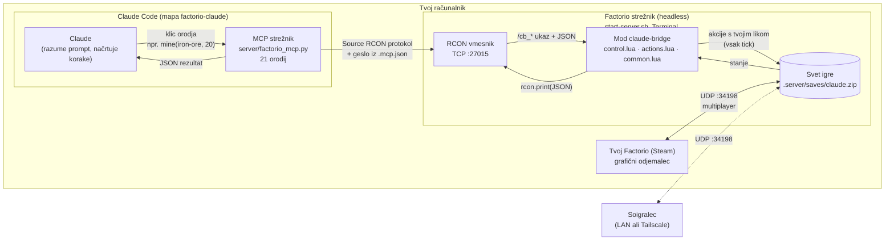
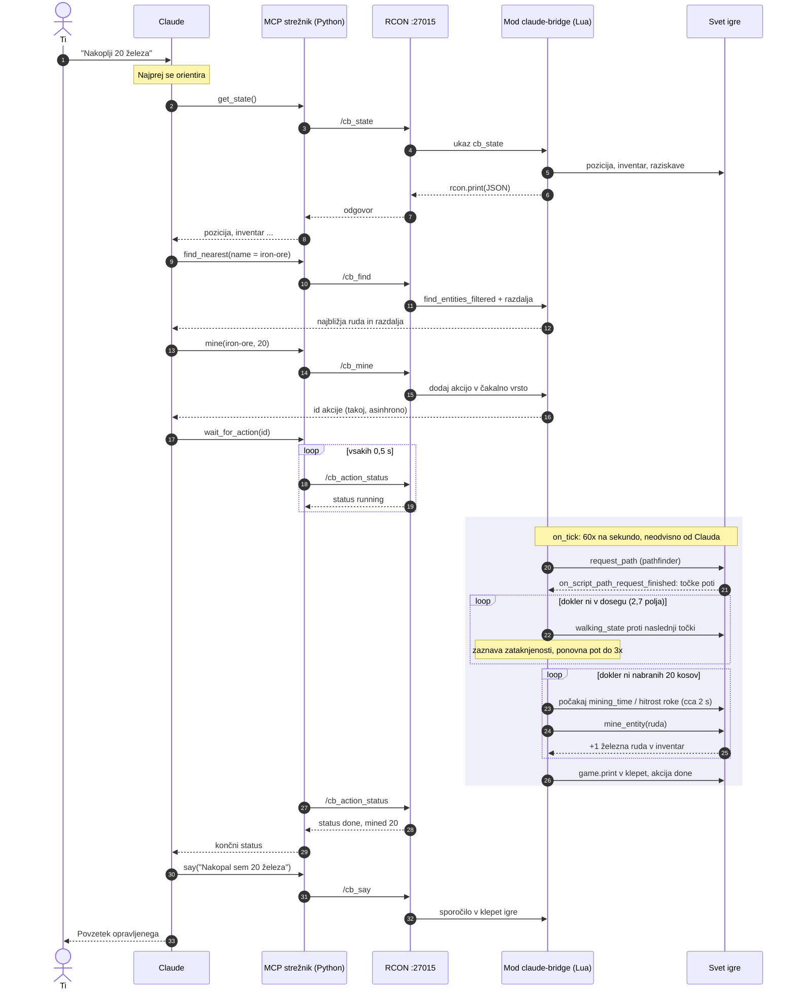

# Factorio × Claude

Igraj Factorio s prompti. Claudu napišeš npr. *"nakoplji 20 železa in postavi peč"*. Claude to izvede **s tvojim likom po pravilih igre**: hodi s pathfindingom, rudari s hitrostjo roke, gradi samo iz inventarja in znotraj dosega.

Preizkušeno s Factorio 2.0.77 in 2.1.24 (Steam, macOS) in Python MCP SDK 2.3. Mod v `info.json` zahteva `factorio_version` 2.1; za starejšo različico ga popravi.

## Arhitektura

Factorio mod ne more v omrežje. Edini most do zunanjega sveta je **RCON** (oddaljena konzola strežnika). Zato je projekt sestavljen iz treh delov:

1. **Mod `claude-bridge`** (Lua) teče v igri in ponuja ukaze `/cb_*`.
2. **MCP strežnik** (Python) se prek RCON poveže na igro in te ukaze ponudi Claudu kot orodja.
3. **Claude Code** razume tvoj prompt in kliče orodja.



- **Strežnik** (`start-server.sh`) je Factorio brez grafike. V njem je svet, simulacija teče na njem in nanj je naložen mod.
- **Tvoja igra iz Steama** je samo odjemalec. Svet riše in pošilja tvoje ukaze (WASD, gradnja), kot na vsakem multiplayer strežniku.
- **Claude** pošilja ukaze prek RCON. Mod jih izvede s tvojim likom in rezultat vrne kot JSON.
- Ti vse vidiš v živo, Claude pa v klepet igre piše, kaj počne.

## Potek enega prompta

Asinhrone akcije (`walk_to`, `mine`) takoj vrnejo id. Mod jih nato izvaja v `on_tick`, neodvisno od Clauda, Claude pa čaka na rezultat z `wait_for_action`.



## Komponente

| Del | Datoteka | Naloga |
|---|---|---|
| Mod: ukazi | `mod/claude-bridge/control.lua` | Registrira ukaze `/cb_*`. Argumenti in odgovori so JSON (`helpers.json_to_table` / `table_to_json`), napake vrača kot `{ok:false, error}`. |
| Mod: akcije | `mod/claude-bridge/actions.lua` | Čakalna vrsta dolgih akcij (hoja, rudarjenje) v `storage`. Izvaja se v `on_tick`, ena akcija naenkrat. |
| Mod: pomočniki | `mod/claude-bridge/common.lua` | Iskanje igralca in entitet, opis entitet, smeri, inventarji. |
| MCP strežnik | `server/factorio_mcp.py` | Lasten RCON odjemalec in orodja za Clauda. |
| Konfiguracija | `.mcp.example.json` → `.mcp.json` | Registracija strežnika `factorio` za Claude Code in RCON geslo. `.mcp.json` ni v gitu. |
| Zagon | `start-server.sh` | Lokalni headless strežnik z ločeno mapo `.server/`, vrata 34198 in RCON 27015. |
| Test | `server/smoke_test.py` | Celoten tok brez igralca (`/cb_debug_spawn`). |

## Namestitev

```bash
cp .mcp.example.json .mcp.json        # v .mcp.json vpiši svoje RCON geslo
python3 -m venv server/.venv
server/.venv/bin/pip install -r server/requirements.txt
```

`start-server.sh` pričakuje Factorio iz Steama na macOS. Pot do programa po potrebi popravi v skripti.

## Zagon

RCON deluje samo v strežniškem načinu, zato igraš na lokalnem strežniku.

1. V terminalu zaženi `./start-server.sh` (nov zemljevid) ali `./start-server.sh "ime savea"` (kopija tvojega savea).
   Terminal pusti odprt. Ctrl+C ustavi strežnik in shrani igro v `.server/saves/claude.zip`.
   **Pozor:** `claude.zip` se zapiše samo ob čistem izhodu. Med igro napredek hranijo samodejni shranjeni stanji `.server/saves/_autosave1-5.zip` (vsakih 5 minut). Po sesutju ali prisilnem ustavitvi zadnji `_autosave` skopiraj čez `claude.zip`.
2. Odjemalec mora imeti isti mod, sicer povezava ne uspe (*ModsMismatch*). Enkrat naredi simbolno povezavo:
   ```bash
   ln -sfn "$PWD/mod/claude-bridge" "$HOME/Library/Application Support/factorio/mods/claude-bridge"
   ```
3. Zaženi Factorio iz Steama in izberi **Multiplayer → Connect to address → `127.0.0.1:34198`**.
4. Odpri Claude Code v tej mapi in odobri MCP strežnik `factorio`.
5. Piši npr. *"poglej okolico in nakoplji 20 železa"* ali *"postavi kurilni rudnik na premog in ga napolni"*.

Hiter test v igri (konzola, tipka `~`): `/cb_state`. RCON lahko preveriš z ukazom `nc -z 127.0.0.1 27015 && echo "RCON dela"`.

## Orodja, ki jih ima Claude

- **Branje:** `get_state`, `scan_area` (rudna polja z mejami in količinami), `ascii_map`, `find_nearest`, `inspect`, `recipe`, `research_options`
- **Asinhrono:** `walk_to`, `mine`, nato `wait_for_action`, `action_status`, `cancel_actions`. Akcije se izvajajo zaporedno.
- **Takojšnje:** `craft`, `place`, `pickup`, `insert_items`, `take_items`, `set_recipe`, `rotate`, `start_research`, `say`

## Test brez igre

`server/smoke_test.py` preveri celoten tok na headless strežniku brez igralca: hoja, rudarjenje, izdelovanje, gradnja.
Pri tem uporabi ukaz `/cb_debug_spawn`, ki ustvari testni lik in deluje samo, ko ni povezan noben igralec.
Strežnik mora teči z `auto_pause: false`, sicer brez igralcev stoji. `start-server.sh` privzeto nastavi `auto_pause: true` (igra se ustavi, ko ni igralcev), zato za test to vrednost začasno spremeni v skripti.

## Igranje z drugimi

- **LAN:** soigralec se poveže na `<IP tvojega računalnika>:34198` (na macOS: `ipconfig getifaddr en0`).
- **Internet:** preusmeritev UDP 34198 na routerju ali Tailscale. Steam povabila ne delujejo, ker headless strežnik ne uporablja Steamovega povezovanja.
- Strežnik teče samo, dokler je terminal odprt.
- Igra teče v realnem času (~60 tickov/s), kot pri človeku. Z `auto_pause` se ustavi, ko ni povezanega odjemalca.

## Spoznanja

- **Mod ne more v omrežje.** Edini most do zunanjega sveta je RCON.
- **RCON deluje samo v strežniškem načinu** (`--start-server`). Pri gostovanju iz menija (*Host game*) se ne zažene, tudi če so v Steamu nastavljene Launch Options.
- **Steam verzija ignorira argumente iz terminala.** Ob zagonu mimo Steama se ponovno zažene prek Steama in izgubi `--rcon-*`. Headless strežnik teče brez tega.
- Strežnik potrebuje **ločeno write-data mapo** (`-c config.ini`), sicer se zaklene z odprto igro.
- `mine_entity` na rudi vrne `false`, čeprav kos nabere, zato se napredek preverja po inventarju.
- **Dosežki:** z vklopljenim modom Factorio dosežke vodi ločeno (modded) in jih **ne pošlje v Steam**.

## Opombe

- Med hojo ne pritiskaj WASD, ker se boš boril s Claudom za lik. `cancel_actions` ustavi vse akcije.
- Med rudarjenjem lik samo stoji, brez animacije.
- Lua napake najdeš v `.server/factorio-current.log`.

## Odprto

- [ ] Izbira igralca, ki ga Claude upravlja (`FACTORIO_PLAYER`), ali Claudov lastni lik. Zdaj prevzame prvega povezanega igralca.
- [ ] Geslo za vstop v igro pred skupno igro. RCON je zaščiten z geslom iz `.mcp.json` in vezan samo na `127.0.0.1` (`--rcon-bind`), vstop v igro pa je brez gesla.
- [ ] Animacija rudarjenja.
